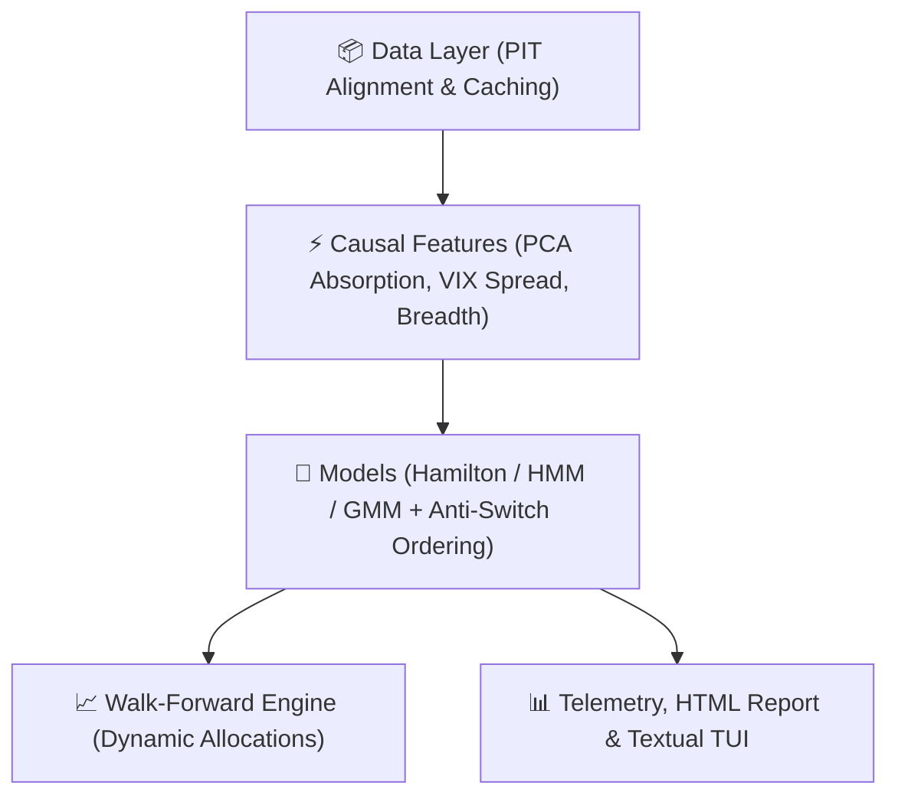

<div align="center">

# 🏛️ RegimeLab

**Institutional-grade market regime detection, systemic risk telemetry, and walk-forward asset allocation engine in Python.**

[](https://pypi.org/project/regimelab/)
[](https://www.python.org/downloads/)
[](https://opensource.org/licenses/MIT)
[](https://mypy-lang.org/)
[](https://github.com/astral-sh/ruff)

</div>

---

## ⚡ Why RegimeLab?

Most open-source regime detection scripts fit a Hidden Markov Model (HMM) on the entire in-sample dataset and claim predictive power. In production quantitative finance, this fails due to three fatal flaws:

1. **Look-Ahead Bias:** Training filters without strict point-in-time (`asof`) truncation leaks future distribution moments into past states.
2. **Label Switching:** HMM/GMM state indices are mathematically interchangeable between refits. Without canonical sorting, "State 0" randomly alternates between Bull and Bear across rolling windows.
3. **Calendar Desynchronization:** Multi-asset cross-sections suffer from holiday mismatches, halted assets, and survivorship bias.

**RegimeLab** solves these operational hurdles, providing a turnkey, causal quantitative engine for systematic asset allocation and macro risk monitoring.

---

### 📊 Feature Matrix: Raw Tooling vs. RegimeLab

| Challenge | Raw `hmmlearn` / `statsmodels` | RegimeLab Framework |
| :--- | :--- | :--- |
| **State Labeling** | Unordered integer states (permutes on refit) | **Deterministic Canonical Sorting** ($\frac{\mu}{\sigma}$ / conditional vol ordering) |
| **Temporal Clock** | In-sample full-sample fitting (Look-ahead) | **Strict Point-in-Time (`asof`) cursor** & expanding-window walk-forward |
| **Systemic Risk** | None | **Kritzman Absorption Ratio (PCA)**, VIX Term Spread & Sector Breadth |
| **Execution Reality** | Pure theoretical classification | **Walk-Forward Backtester** with transaction costs (bps) and confidence floors |
| **Data Ingestion** | Expects clean 2D NumPy array | **Multi-Asset PIT Alignment**, staleness budgets, synthetic & Parquet providers |
| **Reporting** | Matplotlib static plot | **Interactive Plotly HTML reports** + Textual TUI Terminal Dashboard |

---

## 🚀 Quickstart

### 1. Installation

```bash
# Install from PyPI
pip install regimelab

# Or install with interactive TUI support
pip install "regimelab[tui]"
```

### 2. Python API Usage

#### Current Market Regime Detection (3 lines)

```python
from regimelab import Settings
from regimelab.pipeline import run_single_asof

# Run point-in-time regime inference for any historical or current date
settings = Settings(data={"provider": "yfinance"})
payload = run_single_asof(settings, asof="2024-12-31")

print(f"Detected Regime: {payload.regime.value}")
print(f"Confidence: {payload.probabilities.confidence:.2%}")
print(f"Target Allocation: {payload.target_weights.weights if payload.target_weights else {}}")
```

#### Extract Causal Systemic Risk Features

```python
from regimelab import Settings
from regimelab.data.fetcher import load_aligned_panel
from regimelab.features import build_feature_matrix

settings = Settings(data={"provider": "yfinance"})
panel = load_aligned_panel(settings)
features = build_feature_matrix(panel, settings)

# Inspect causal feature matrix
print(features[["absorption_ratio", "absorption_delta", "vix_term_spread", "breadth"]].tail())
```

#### Walk-Forward Backtesting Engine

```python
from regimelab import Settings
from regimelab.pipeline import run_pipeline

settings = Settings(
    data={"provider": "synthetic"}, # Fully offline, reproducible dataset
    model={"classifier": "hmm", "n_states": 4},
    backtest={"transaction_cost_bps": 5.0, "confidence_floor": 0.5},
)

result = run_pipeline(settings, command="backtest_run")
metrics = result.backtest.metrics

print(f"Strategy CAGR: {metrics.cagr:.2%}")
print(f"Sharpe Ratio:  {metrics.sharpe:.2f}")
print(f"Max Drawdown:  {metrics.max_drawdown:.2%}")
```

### 3. CLI & Terminal Dashboard

RegimeLab ships with a powerful Typer CLI:

```bash
# 1. Run full walk-forward pipeline and generate interactive HTML report
regimelab run --report market_report.html

# 2. Inspect point-in-time telemetry for a specific date (JSON output)
regimelab asof 2023-10-15

# 3. Launch the full interactive Textual Terminal Dashboard
regimelab tui
```

Additional CLI commands include `regimelab report OUTPUT` for direct HTML generation and `regimelab asof YYYY-MM-DD --output telemetry.json` for persisted JSON payloads.

---

## 🧠 Core Methodology & Architecture



### 1. Canonical State Labeling (`regimelab.models.labeling`)

To eliminate label switching, RegimeLab fits the underlying statistical model (Gaussian HMM, Hamilton Markov Switching, or GMM) and evaluates the conditional distribution parameters of each state. States are sorted by risk-adjusted return ($\frac{\mu}{\sigma}$) and mapped deterministically to:

- **BULL_TREND** (High return, low volatility)
- **NEUTRAL_TRANSITION** (Moderate return, mean-reverting)
- **HIGH_VOL_BEAR** (Negative drift, elevated variance)
- **RISK_OFF** (Severe drawdown regime)

### 2. Kritzman Absorption Ratio (`regimelab.features.absorption`)

Quantifies market fragility via Principal Component Analysis (PCA) over rolling multi-asset return covariance matrices:

$$
\text{Absorption Ratio} = \frac{\sum_{i=1}^{k} \sigma^2_{PC_i}}{\sum_{j=1}^{N} \sigma^2_j}
$$

A rapid spike in the absorption ratio ($\Delta \text{AR} > 1.5$) indicates tightening cross-asset coupling, signaling systemic vulnerability prior to market crashes.

---

## ⚙️ Configuration (`regimelab.toml`)

Customize execution parameters via `regimelab.toml`, environment variables (`REGIMELAB_DATA__PROVIDER=yfinance`), or Python kwargs:

```toml
[data]
provider = "yfinance"          # "yfinance", "synthetic", or "parquet"
start = "2005-01-01"
benchmark = "SPY"
calendar_anchor = "SPY"

[model]
classifier = "hmm"             # "hmm", "gmm", or "hamilton"
n_states = 4
covariance_type = "diag"
min_train_observations = 756

[backtest]
transaction_cost_bps = 5.0
confidence_floor = 0.5
refit_frequency_days = 63
```

---

## 🧪 Testing & Formal Verification

RegimeLab is built with property-based testing (hypothesis) to mathematically guarantee absence of look-ahead leakage:

```bash
# Run test suite with causality property tests
uv run pytest -q

# Run strict mypy type checking
uv run mypy src/regimelab

# Lint with ruff
uv run ruff check .
```

---

## 📄 License

MIT License. Developed for quantitative researchers, portfolio managers, and systematic trading engineers.
